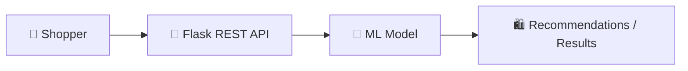

<div align="center">


<b><i>Python-powered online shopping web application</i></b>


   

   
</div>

---

## 🛍️ About the Project

An **e-commerce web application** for online shopping built with **Python and Flask**. It includes a REST API layer and an ML model trained on e-commerce data, plus sample abstracts used for project guidance.

## ✨ Key Features

- 🛒 Product listing & shopping flow
- 🔌 REST API endpoints (see `Rest_API.txt`)
- 🤖 ML model trained on `Ecommerce.csv` (`model.py`)
- 📝 Sample project abstracts and title lists

## 🧠 How It Works



## 🛠️ Tech Stack

| Layer | Technology |
|---|---|
| Language | Python 3 |
| Web/API | Flask · REST |
| ML | scikit-learn · Pandas |
| Data | Ecommerce.csv |

## 📂 Project Structure

```text
E-commerce/
├── app.py / E_commerce_app.py   # Flask apps
├── model.py                     # ML training
├── Ecommerce.csv
├── Rest_API.txt                 # API reference
└── Abstract_titles.txt · Banglore_Abstracts.txt · Abstarct_Sample.txt
```

## 🚀 Getting Started

```bash
git clone https://github.com/PreciousBharath/E-COMMERCE.git
cd E-COMMERCE/E-commerce
pip install flask pandas scikit-learn
python app.py
```

## 🤝 Contributing

Contributions, issues and feature requests are welcome! Feel free to ⭐ star the repo and open a pull request.

## 👨‍💻 Author

<div align="center">

**Bharath** — Software Developer · Project Engineer · Technical Trainer

<a href="https://github.com/PreciousBharath"></a>
<a href="https://linkedin.com/in/connectbharath"></a>

### 🍔 EAT · 😴 SLEEP · 💻 CODE · 🔁 REPEAT

⭐ **If you found this project useful, give it a star!** ⭐


</div>
